# AiPhoneKVM

Android 蓝牙键鼠、媒体遥控、TV、Xbox/FC 布局与可配置的视觉自动化。此项目基于 BT Remote / android-bt-remote 修改，**不是上游官方发布**。来源、修改范围和依赖许可见 [NOTICE.md](NOTICE.md) 与 [THIRD_PARTY_NOTICES.md](THIRD_PARTY_NOTICES.md)。

## 功能

- 主控使用 Bluetooth Classic HID 发送键盘、鼠标、媒体和手柄报告；Android 9+，设备需支持 BluetoothHidDevice。
- 首页八个功能独立进入，底部“蓝牙设备”集中选择、搜索和本机可发现授权。选择设备仅保存目标，点功能才连接。
- 竖屏键鼠与横屏键盘分类配色，F/J 红色；Xbox/FC 进入时临时全屏，退出释放输入。
- 屏幕观察可使用截图助手，或显式开启的主控摄像头。真实相机闭环须固定摆放、框选和鼠标落点校准。
- 模型采用可配置的兼容 Chat Completions 图像接口。单步建议与有边界的目标循环均在操作后获取新画面；不能把动作发送成功当作任务完成。
- 可选局域网 HTTP 控制台、MQTT 和自建 HTTPS 网站；需要自行部署、配置与鉴权。

## 功能截图

以下为 2.9.4 的界面截图，使用无秘密的示例配置；点击图片可查看原图。AI 状态、摄像头画面及网页设备数据包含模拟示例，实际功能验收范围见[验收记录](docs/QA.md)。

| 首页与八个功能入口 | 蓝牙设备管理 | 应用设置 |
| :---: | :---: | :---: |
| <a href="docs/screenshots/controller/C05-home-selected-UI_TEST.png">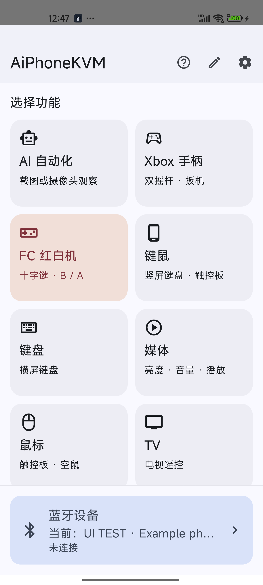</a> | <a href="docs/screenshots/controller/C10-device-paired-01-UI_TEST.png">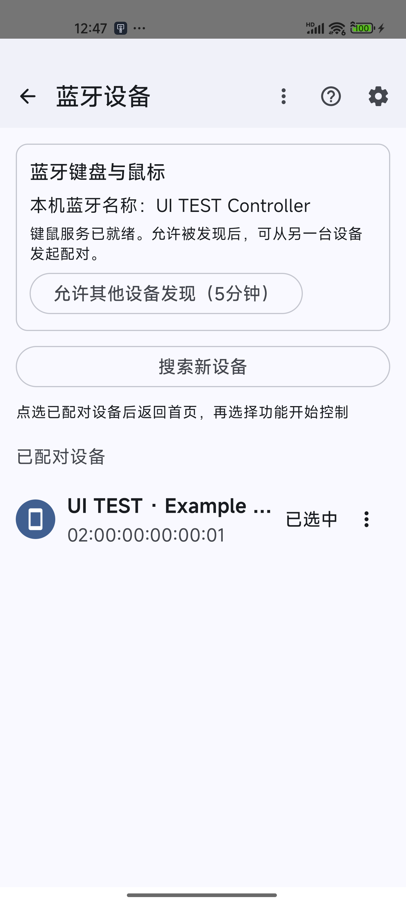</a> | <a href="docs/screenshots/controller/C24-settings-01-UI_TEST.png">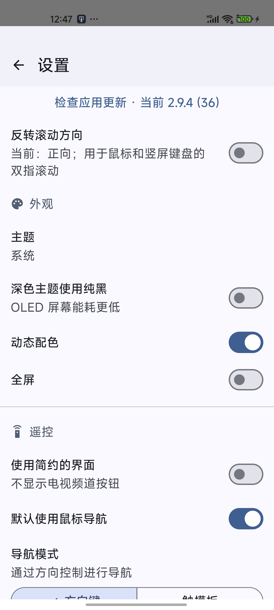</a> |

| 竖屏键鼠 · F/J 红色 | 鼠标与空鼠界面 | 媒体遥控 |
| :---: | :---: | :---: |
| <a href="docs/screenshots/controller/M01-compact-letters-UI_TEST.png">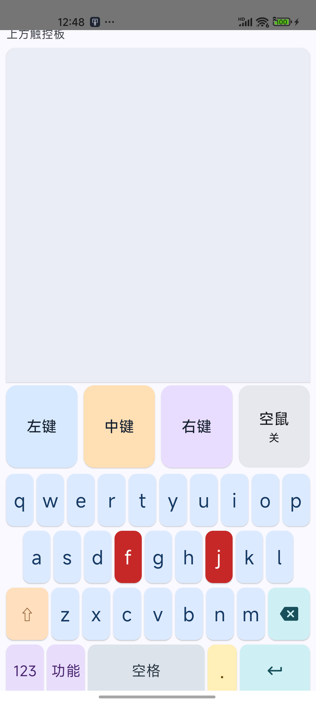</a> | <a href="docs/screenshots/controller/M08-mouse-UI_TEST.png">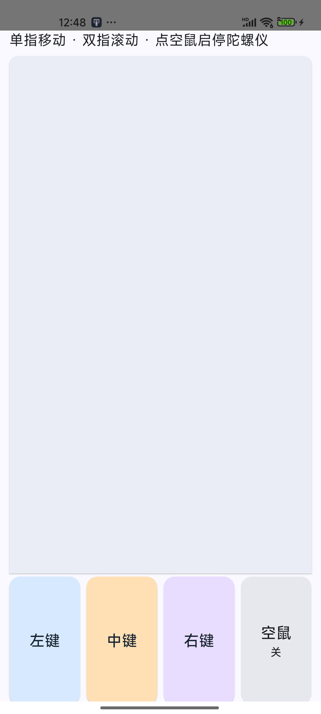</a> | <a href="docs/screenshots/controller/M07-media-01-UI_TEST.png">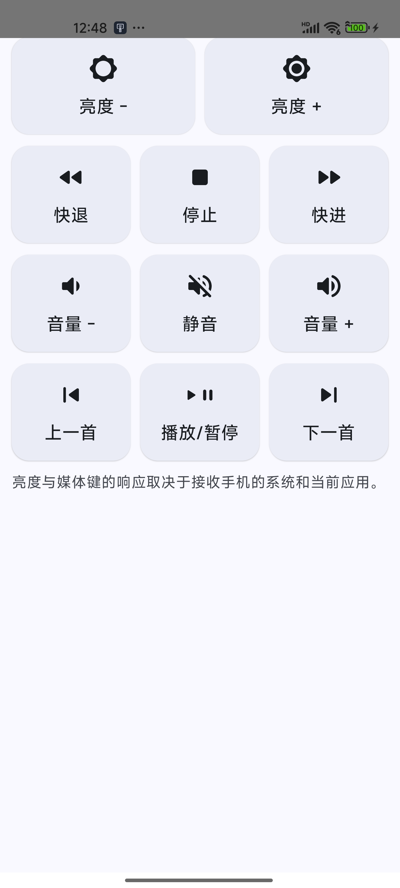</a> |

| AI 任务 | 模型与自动化设置 | 手机端网站绑定 |
| :---: | :---: | :---: |
| <a href="docs/screenshots/controller/A01-task-default-01-UI_TEST.png">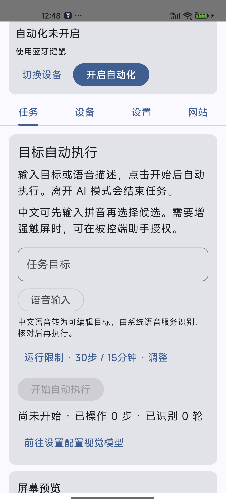</a> | <a href="docs/screenshots/controller/A14-ai-settings-01-UI_TEST.png">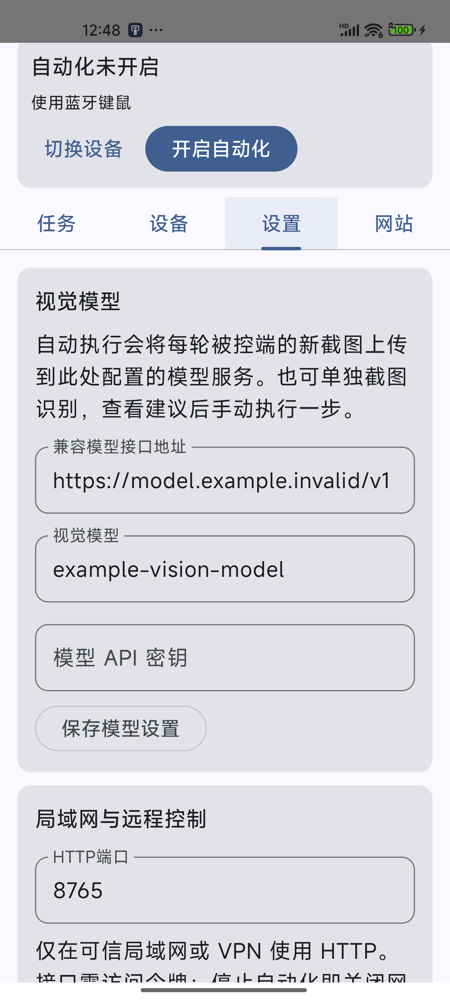</a> | <a href="docs/screenshots/controller/A18-website-tab-01-UI_TEST.png">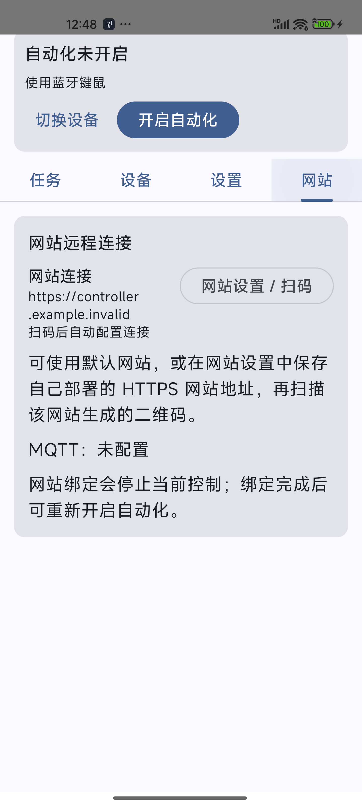</a> |

| TV 遥控 | 摄像头观察 · 合成画面示例 | 被控端截图助手 |
| :---: | :---: | :---: |
| <a href="docs/screenshots/controller/M09-tv-complete-UI_TEST.png">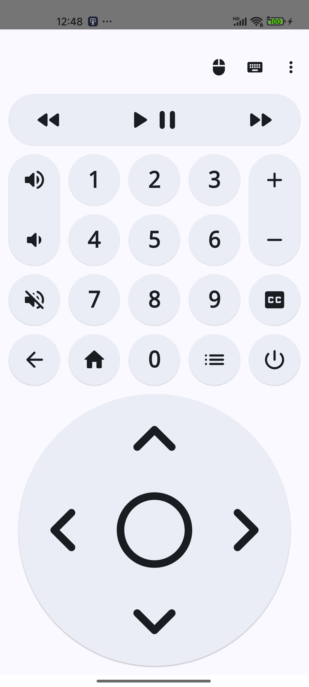</a> | <a href="docs/screenshots/controller/A11-synthetic-camera-live-01-UI_TEST.png">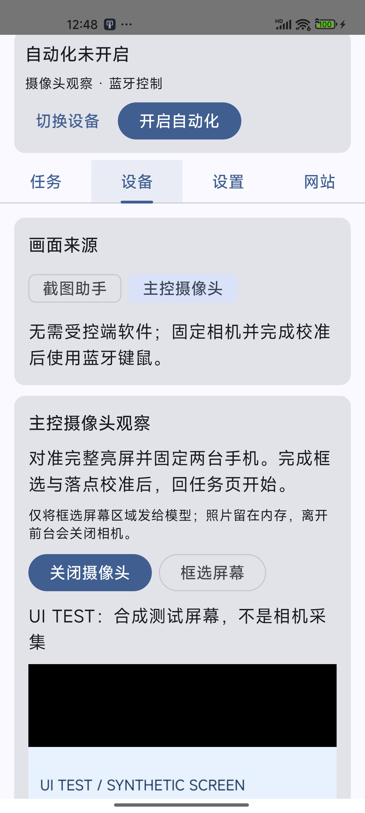</a> | <a href="docs/screenshots/capture/H01-default-example-UI_TEST.png">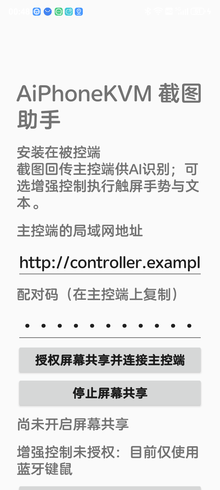</a> |

### 横屏键盘

F/J 使用红色，字母、数字、符号、修饰键和功能区用不同颜色区分。

<a href="docs/screenshots/controller/M06-landscape-keyboard-UI_TEST.png">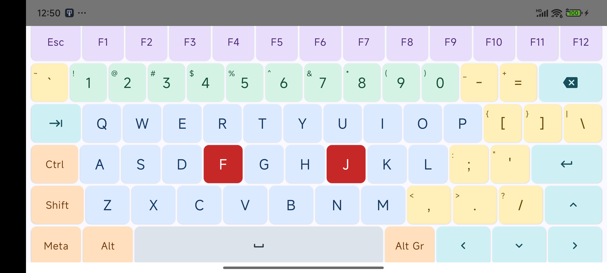</a>

### 游戏手柄

| Xbox 布局 | FC 红白机布局 |
| :---: | :---: |
| <a href="docs/screenshots/controller/M16-xbox-UI_TEST.png">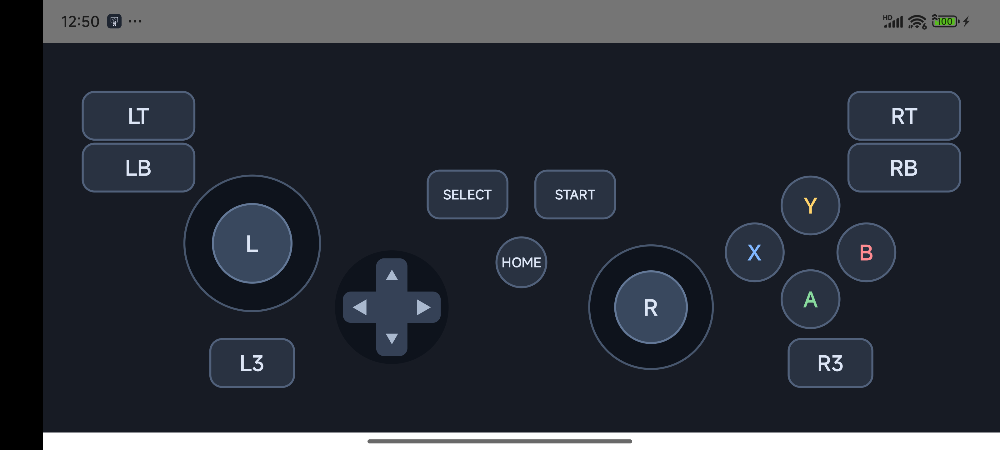</a> | <a href="docs/screenshots/controller/M17-fc-UI_TEST.png">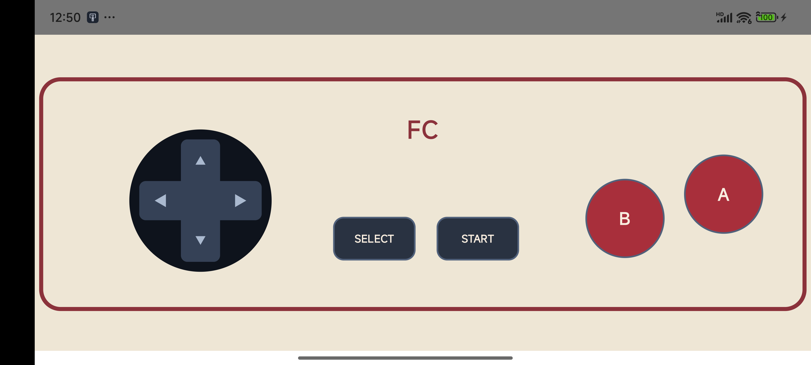</a> |

### 网站与局域网控制台

网站设备管理与任务入口（示例数据）：

<a href="docs/screenshots/web/W06-online-UI_TEST.jpg">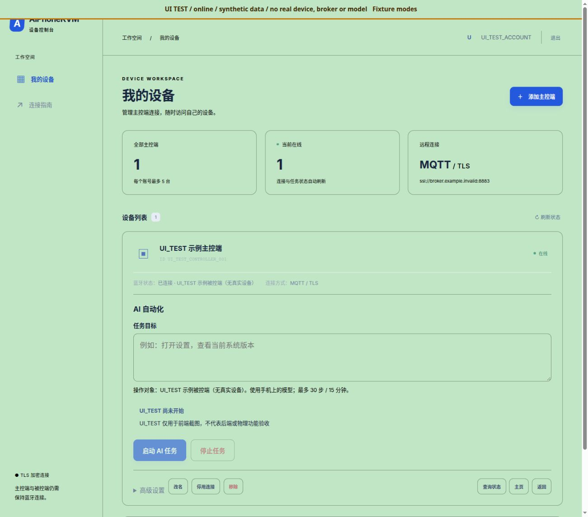</a>

局域网控制台（示例状态）：

<a href="docs/screenshots/web/L02-lan-connected-UI_TEST.jpg">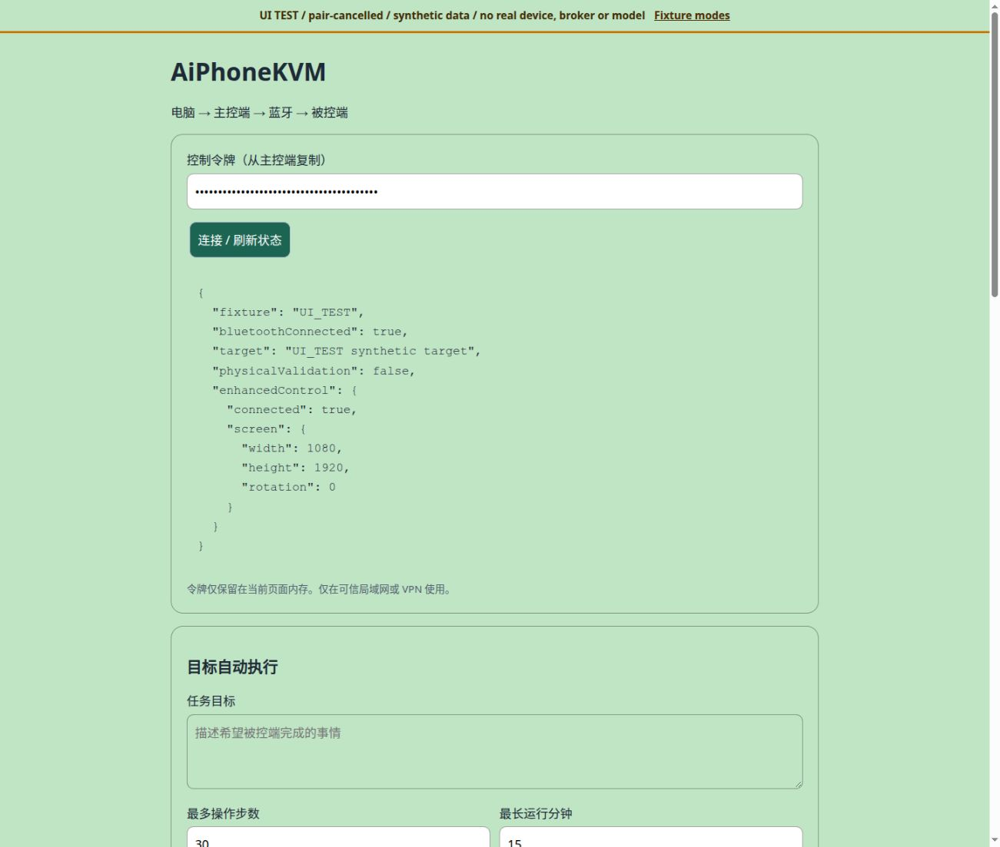</a>

[查看全部 142 张逐页截图、更多状态与弹窗](docs/screenshots/README.md)。

## 默认配置与隐私

公开版没有可用的默认服务器或模型：网站为 `https://controller.example.invalid`，模型为 `https://model.example.invalid/v1`，模型名称为 `example-vision-model`，更新站点为无效示例。`.invalid` 域名仅供说明，不是在线服务。填写你自己的 HTTPS 地址和密钥后才可使用网络/模型功能。更换模型地址需重新填写密钥，原密钥不会转发给新服务。

手机中的已保存设置属于本机私有数据。不要把私有配置、配对码、数据库、密钥、设备列表、原始测试记录或含个人信息的截图提交到仓库。截图会发送给你所配置的模型服务；使用前应确认画面与数据范围。应用保留既有包标识以支持升级，它不代表服务器地址。旧版未保存站点地址时，升级后需填写自己的站点并重新绑定。

## 下载与验收

当前 2.9.4 为审计测试版。用户已确认手点 TV 入口可正常进入；TV 完整按键实控、真实相机光学闭环、语音和空鼠体感仍有待验收项目，详见验收记录。

安装包和对应源码见 [GitHub Releases](https://github.com/wyang1212/AiPhoneKVM/releases)。[逐页截图索引](docs/screenshots/README.md)区分示例界面与实际功能验收，详细结果和限制见 [验收记录](docs/QA.md)。

## 使用

1. 安装主控，允许所需的附近设备权限；在“蓝牙设备”中配对并选择目标。
2. 返回首页进入键鼠、键盘、媒体、鼠标、TV 或手柄。目标系统可能不接受部分 HID 类型或媒体键，应以实际接收结果为准。
3. 如需自动化截图，在目标安装截图助手，按主控设备页说明填写主控地址和专用配对码，显式开启整屏共享。增强触控需要另行授权无障碍。
4. 在 AI 自动化的设置页填写自己的模型配置。先用合成测试页面验证单步，再运行明确、有限的任务；停止、离页与断线会取消并释放输入。
5. 网站入口仅在 AI 自动化的“网站”标签。自建部署见 [mqtt-portal/README.md](mqtt-portal/README.md)。

## 构建与测试

需要 JDK 21、Python 3、Android SDK（API 36），Gradle Wrapper 版本见 `src/gradle/wrapper/gradle-wrapper.properties`。仓库不包含开发者签名私钥；自己的发布签名通过本地配置提供，禁止提交。

```bash
python3 tools/build_android.py :app:assembleDefaultDebug :app:testDefaultDebugUnitTest :app:lintDefaultDebug :capture:assembleDebug :capture:testDebugUnitTest :capture:lintDebug
```

主控输出在 `src/app/build/outputs/apk/default/debug/`，截图助手在 `src/capture/build/outputs/apk/debug/`。Debug 安装包用于测试；不同签名不能直接覆盖原有安装。修改 `src/gradle.properties` 的版本名称与代码可构建新版本。可通过 Gradle `-P` 参数覆盖网站与更新站点；更新站点设为空可禁用更新检查。

```bash
python3 tools/build_android.py :app:assembleDefaultDebug -Paiphonekvm.websiteOrigin=https://controller.example.invalid -Paiphonekvm.updateOrigin=
python3 tools/privacy_check.py .
python3 tools/package_source.py
```

独立截图测试包可用 `-Paiphonekvm.applicationId=org.example.aiphonekvm.audit` 构建，不会覆盖既有主控数据。公开页面图使用隔离配置与示例状态，不等同于真实模型、相机光学校准或第三方主机兼容验收。实际覆盖和已知限制见 [docs/QA.md](docs/QA.md)。

## 源码与许可证

整体派生项目按 GPL-3.0 分发；对应源码、构建文件、原版权及许可证随仓库提供。Apache/BSD/EPL/EDL/MIT 等第三方组件按各自许可保留。不要把整个项目改标为单一宽松许可证。主控设置页及截图助手的“开源声明”提供组件来源。安全问题报告方式见 [SECURITY.md](SECURITY.md)。
